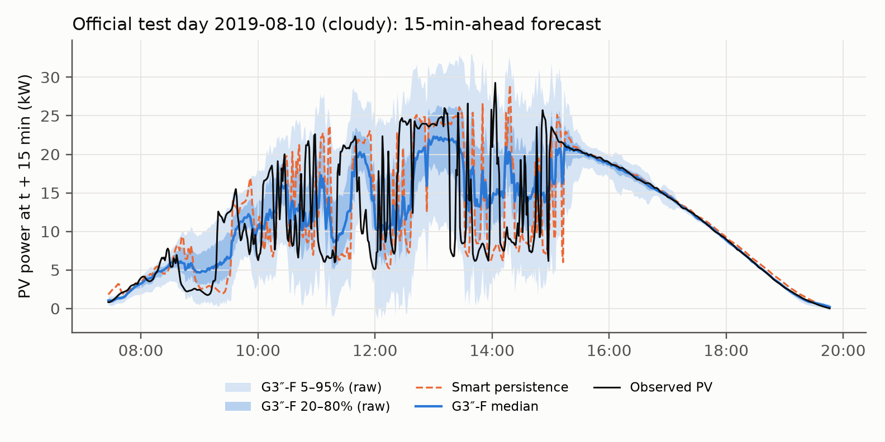
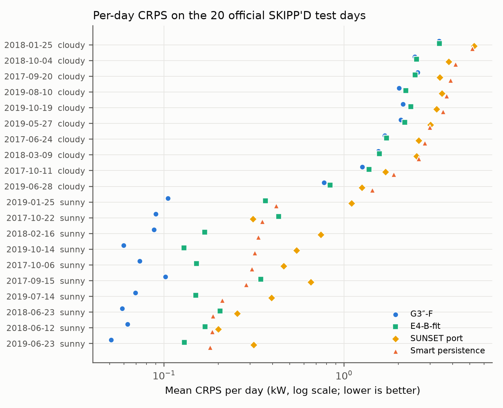
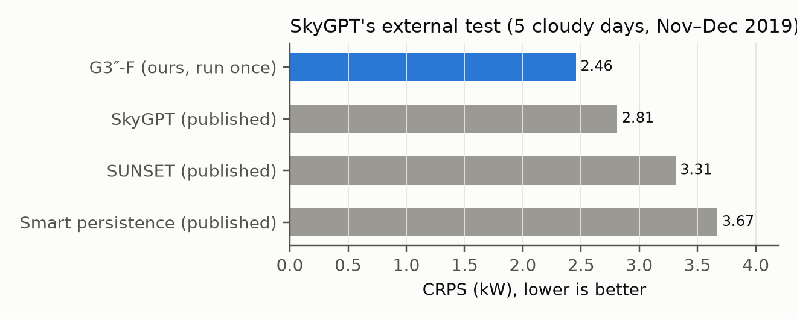
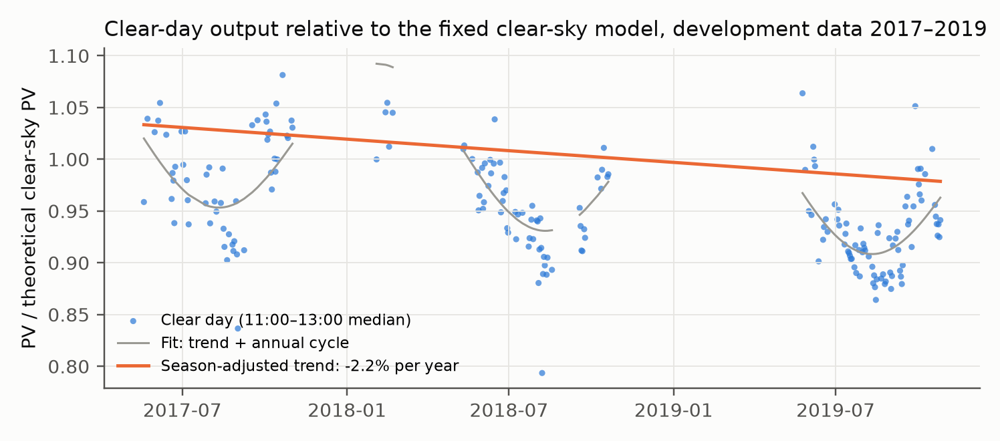
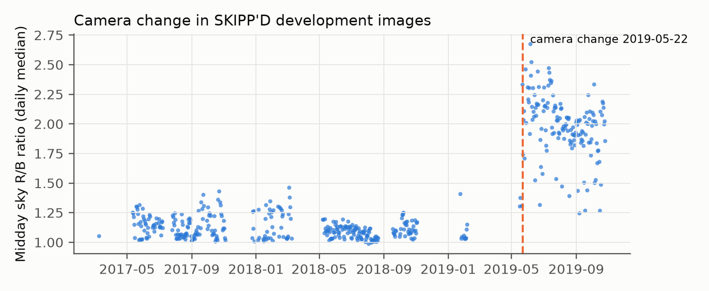
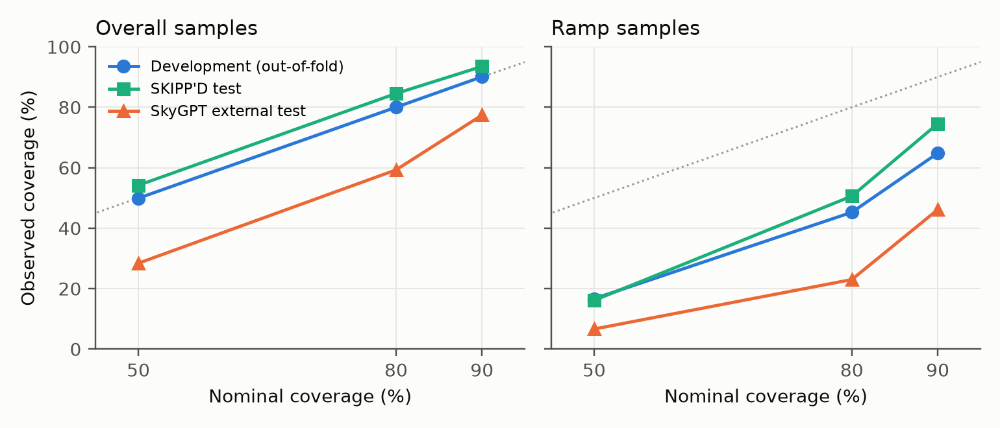

# SHADOW-MoE: probabilistic 15-minute solar power forecasting from sky images

A gated mixture of sky-image experts forecasts rooftop PV power 15 minutes ahead as a full probability distribution, using the Stanford **SKIPP'D** benchmark. Every model decision was pre-registered, and the official test set was evaluated **exactly once**.

**Headline result (official 20-day SKIPP'D test set, 13,266 forecasts).** The final model **G3″-F** lowers the overall CRPS against the strongest single model (E4-B-fit) from **1.117 to 1.006 kW (−9.9%)**. The paired test-day bootstrap 95% CI of the difference is **[−0.149, −0.075] kW**, so the pre-registered primary hypothesis is confirmed. Two secondary hypotheses were **not** met: ramp non-inferiority, and 90% interval coverage within ±3 percentage points of nominal. Both are reported below.

**Against published models (Phase A, pre-registered; section 3.6).**

| Comparison | Ours (G3″-F) | Published |
|---|---|---|
| SKIPP'D 20-day test, official exact-timing samples: RMSE / forecast skill | **2.949 kW / 18.1%** | SUNSET 3.03 kW / 16.4% |
| SkyGPT's own external test (5 cloudy days, Nov–Dec 2019, 2,582 samples, run once): CRPS | **2.455 kW** | PV-MM-Diffusion 2.63 · SkyGPT 2.81 · SUNSET 3.31 · persistence 3.67 |
| Same SkyGPT test: Winkler score (90%) | **18.16** | PV-MM-Diffusion 21.46 · SkyGPT 26.70 · SUNSET 56.95 |

These are comparisons against published point estimates. SkyGPT's per-sample predictions are not public, so no paired test was possible. On the external cloudy days the intervals under-cover (90% coverage 0.77), and ramps are no better than with the single direct expert.

---

## Contents
1. [Problem and data](#1-problem-and-data)
2. [How the model works](#2-how-the-model-works)
3. [Results on the official test set](#3-results-on-the-official-test-set)
4. [Development history: every experiment](#4-development-history-every-experiment)
5. [Research protocol and integrity](#5-research-protocol-and-integrity)
6. [Repository layout](#6-repository-layout)
7. [Reproducing the work](#7-reproducing-the-work)
8. [Limitations](#8-limitations)
9. [Citation, data and licences](#9-citation-data-and-licences)
10. [Roadmap and status](#10-roadmap-and-status)

---

## 1. Problem and data

**Task.** At each time *t*, forecast the PV power at *t* + 15 min from the sky images up to *t*. The output is 9 quantiles (5, 10, 20, 30, 50, 70, 80, 90 and 95%), which together form a full predictive distribution.

**Dataset.** SKIPP'D (SKy Images and Photovoltaic Power generation Dataset), Stanford University, 2017–2019. Download: <https://purl.stanford.edu/dj417rh1007> (CC BY 4.0).

| Item | Content |
|---|---|
| Sky images | 64×64 RGB fisheye images of the whole sky, one per minute |
| PV power | 1-minute output of a ≈ 30 kW rooftop array, in kW |
| Timestamps | Local time of every image/PV pair |
| Development split | 349,372 records over 497 days, giving 164,362 forecast samples |
| Official test split | 14,003 records over 20 fixed days (10 sunny, 10 cloudy), giving 13,266 forecast samples |

The data has **no** cloud labels, irradiance sensor or weather variables. The link between cloud and power is learned from the images (section 2).

**Sample construction.**
- Each sample uses 16 frames (*t*−15 … *t* min) and the PV target at *t* + 15 min.
- The public benchmark is thinned to about one record per minute, and its timestamps drift by up to ±30 s. Exact matching therefore loses 19% of the samples.
- We match each frame to the nearest record within **±30 s**, which recovers the official sample counts (`reports/protocol_notes.md`). This is a documented deviation from the original construction.

**Evaluation metric.** CRPS (continuous ranked probability score) in kW; lower is better.
- For a point forecast, CRPS equals the mean absolute error, so deterministic baselines are scored on the same scale.
- We also report RMSE and MAE of the median, interval coverage, width and interval score.

---

## 2. How the model works

### 2.1 Separating clouds from the sun's daily cycle

1. **Clear-sky power** `P_clear(t)`: the power the array *would* produce under a perfectly clear sky, computed from physics. It combines the sun's position, Ineichen clear-sky irradiance, Hay-Davies transposition to the panel plane (22.5° tilt, 195° azimuth) and an incidence-angle loss. A smooth annual scale factor is fitted on training days only (`src/clear_sky.py`).
2. **Clear-sky index** `K = PV / max(P_clear, 1 kW)`:
   - K ≈ 1 is clear sky;
   - K ≈ 0.3 means a cloud is blocking the sun;
   - K > 1 briefly occurs when cloud edges reflect extra light onto the panels.
3. Every model predicts **future K** from the images and the recent K history. The forecast in kW is `K̂ × P_clear(t + 15 min)`.

Removing the sunrise/sunset and seasonal pattern this way lets the network focus on clouds. It reduced CRPS by 22% on development folds (Gate 2).

### 2.2 The experts

| Name | Input | Architecture | Output | Strength |
|---|---|---|---|---|
| **E4-B-fit** | last 15 min (16 frames, 1-min stride) + K history | per-frame CNN → GRU | 9 quantiles of K | strongest single model; robust on ramps |
| **E6-S** | last 15 min + K history | CNN → GRU + event-mixture head (4 arrival-time classes × 2-component Gaussian severity over ΔK) | mixture → quantiles | very sharp on calm, clear-sky conditions |
| **A2** | last **60 min** (16 frames, 4-min stride) + K history | **3D-CNN** (spatio-temporal) → GRU | 9 quantiles of K | sees cloud motion; best on ramps |
| D4 (descriptive) | last 60 min + hand-crafted sun-position and motion features | CNN → GRU | 9 quantiles | helps ramps but costs overall; not used |

**Training recipe (all experts)**
- AdamW at lr 1e−4 with cosine decay, weight decay 1e−4, gradient clipping 1.0, EMA of the weights (0.999).
- Batch 128, at most 15 epochs, early stopping with patience 5 on the pinball loss.
- The CNN runs in bf16; the GRU and heads in fp32.
- Each expert is trained on 5 blocked folds × 3 seeds (42, 123, 456), i.e. **15 members**.
- A calibration hold-out (every 5th block of 10 training days) is kept out of training. It is used to fit the gates.

### 2.3 G3″-F: the final forecaster

```
                ┌─────────────── 60-min history available? (timestamp rule only) ───────────────┐
                │ yes (93% of test forecasts)                         no (sunrise; 7%)          │
                ▼                                                      ▼                        │
   G3″ = gate( A2 [3D-CNN, 60 min] , E6-S )            G3 = gate( E4-B-fit [15 min] , E6-S )     │
                │                                                      │                        │
                └──────────────► 15-member equal-weight quantile averaging ◄────────────────────┘
                                              │
                         causal rolling-window conformal calibration
                                              │
                               predictive quantiles + 50/80/90% intervals
```

**The gate** is a logistic weight `w` that blends the ramp-robust expert with the calm-condition expert: `q = w · q_ramp + (1 − w) · q_calm`. It uses only forecast-time features:
- the event probability implied by the experts' quantiles;
- the **disagreement** between the two experts.

It is fitted by exact blended-CRPS minimisation on the calibration hold-out days only (`src/gate7b.py`).

**Calibration**
- Intervals are widened or narrowed by a rolling-window conformal correction.
- The correction uses only outcomes already observed at issue time (a 15-minute maturation delay). It resets at each day boundary and starts from development out-of-fold scores (`src/cal2.py`, `src/final_eval.py`).
- No finite-sample coverage guarantee is claimed under temporal dependence.

---

## 3. Results on the official test set

All numbers come from the single pre-registered run (`reports/test_results.json`, `reports/gate5_test_report.md`). Units are kW.

### 3.1 Pre-registered hypotheses

Differences are G3″-F minus the comparator. Bootstrap: 10,000 resamples of test days, stratified sunny/cloudy.

| Hypothesis | Estimate [95% CI] | Verdict |
|---|---|---|
| **H1 (primary): overall CRPS vs E4-B-fit** | **−0.111 [−0.149, −0.075]** | **Confirmed** |
| H2: overall CRPS vs smart persistence | −0.701 [−0.823, −0.582] | Confirmed |
| H2: cloudy-day CRPS vs smart persistence | −1.208 [−1.454, −0.971] | Confirmed |
| H3: ramp non-inferiority vs E4-B-fit (margin 0.02) | −0.117 [−0.244, +0.031] | **Not established** (upper bound > 0.02) |
| H4: RMSE skill vs persistence (descriptive) | G3″-F 18.6%, SUNSET port 16.2% | – |
| H5: calibrated 90% coverage within 0.90 ± 0.03 | 0.935 | **Not met** (too conservative) |

### 3.2 CRPS by condition

| Model | Overall | Sunny | Cloudy | Ramp | Non-ramp | Sunrise ramp | RMSE | MAE |
|---|---|---|---|---|---|---|---|---|
| **G3″-F** | **1.006** | 0.074 | **1.939** | **3.510** | 0.583 | 0.808 | **2.959** | **1.411** |
| E4-B-fit | 1.117 | 0.218 | 2.017 | 3.627 | 0.693 | 0.778 | 3.037 | 1.534 |
| G4 (15-min gate) | 1.024 | 0.073 | 1.976 | 3.782 | 0.558 | 0.802 | 3.033 | 1.429 |
| E6-S | 1.090 | 0.073 | 2.108 | 4.281 | 0.551 | 0.900 | 3.274 | 1.499 |
| SUNSET (our port) | 1.719 | 0.475 | 2.965 | 4.815 | 1.197 | 1.070 | 3.046 | 1.719 |
| Smart persistence | 1.707 | 0.269 | 3.147 | 7.131 | 0.791 | 1.610 | 3.636 | 1.707 |

- **Sample counts:** sunny 6,638; cloudy 6,628; ramp 1,916; sunrise ramp 268.
- **Ramp definition:** |ΔK over 15 min| ≥ 0.279. The threshold was frozen before testing.
- **Per day:** G3″-F beats E4-B-fit on 19 of 20 test days, and persistence and SUNSET on all 20.
- **D4, descriptive, 60-min subset (n = 12,355):** overall +0.008 [−0.015, +0.031] vs E4-B-fit, ramp −0.354 [−0.415, −0.273].

### 3.3 Interval calibration (G3″-F)

| Nominal | Overall coverage | Sunny | Cloudy | Ramp | Width overall | Interval score |
|---|---|---|---|---|---|---|
| 50% | 0.542 | 0.658 | 0.426 | 0.161 | 2.03 | 4.53 |
| 80% | 0.846 | 0.917 | 0.775 | 0.506 | 4.42 | 6.30 |
| 90% | 0.935 | 0.968 | 0.902 | 0.746 | 6.26 | 7.62 |

- **Ramp misses are directional:**
  - on up-ramps, 30% of outcomes fall *above* the 90% interval;
  - on down-ramps, 21% fall *below* it.

  The forecast lags sudden changes.
- **Interval width:** G3″-F's 90% intervals are 24% narrower than E4-B-fit's (6.26 vs 8.20 kW), at higher coverage.

### 3.4 Development vs test

| | Development (497 days) | Official test (20 days) |
|---|---|---|
| G3″-F overall CRPS | 0.573 | 1.006 |
| E4-B-fit overall CRPS | 0.730 | 1.117 |
| H1 difference [95% CI] | −0.157 [−0.170, −0.145] | −0.111 [−0.149, −0.075] |
| Ramp difference [95% CI] | −0.025 [−0.054, +0.005] | −0.117 [−0.244, +0.031] |
| 90% coverage, overall / ramp | 0.901 / 0.651 | 0.935 / 0.746 |

The test days are harder than development: 14.4% of samples are ramps, against 10.0%.

### 3.5 Figures

All figures are in `reports/figures/` (PNG and PDF) and are generated by `python -m src.figures`.

| Figure | Shows |
|---|---|
|  | **F1:** forecast vs observed PV on a cloudy official test day, with the 20–80% and 5–95% bands |
|  | **F2:** per-day CRPS on all 20 test days for G3″-F, E4-B-fit, the SUNSET port and persistence |
|  | **F3:** CRPS on SkyGPT's own external test samples |
|  | **F4:** clear-day PV relative to a fixed clear-sky model shows an apparent decline of about 2.2%/yr (season-adjusted) |
|  | **F5:** the camera change on 2019-05-22, seen in the midday sky R/B ratio |
|  | **F6:** interval coverage on development, the SKIPP'D test and the SkyGPT external test (overall and ramps) |

### 3.6 Comparison with published results (Phase A)

The protocol was pre-registered before execution; the full report is `reports/phaseA_report.md`.

**SUNSET, on the SKIPP'D 20-day test.**
- Our SUNSET port reproduces the published SKIPP'D-paper numbers within 0.03 kW on the exact-timing subset (the official matching rule).
- On that subset, G3″-F has RMSE **2.949 kW** and forecast skill **18.1%**, against **3.03 kW** and **16.4%** for published SUNSET.

**SkyGPT, on its own external test set.**
- The set is 5 cloudy days in Nov–Dec 2019, 2,582 samples, never seen in our development.
- The frozen models were run exactly once on SkyGPT's public test file.
- The population is verified: our smart persistence scores 3.672 against the published 3.67, and our SUNSET port's Winkler score is 56.87 against 56.95.

| Model | CRPS (kW) | Winkler 90% |
|---|---|---|
| **G3″-F** (its 15-min configuration; no 60-min history in the file) | **2.455** | **18.16** |
| Real-future-image → U-Net oracle (from the PV-MM-Diffusion paper) | 2.52 | 30.72 |
| PV-MM-Diffusion (Huang et al., *Applied Energy* 2026; same test set, confirmed from the full text) | 2.63 | 21.46 |
| SkyGPT (published) | 2.81 | 26.70 |
| SUNSET (published) | 3.31 | 56.95 |
| Smart persistence | 3.67 | – |

**Caveats.**
- SkyGPT's per-sample predictions are not public, so this comparison is against published point estimates, not a paired test.
- On these days the calibrated 90% intervals under-cover (0.77), and ramp CRPS is not better than E4-B-fit's.

**Compute.** The complete one-shot run for all models (15 members × 5 models, calibration, bootstraps) took 475 s on an NVIDIA RTX 5000 Ada. That is 35.8 ms per forecast amortised.

---

## 4. Development history: every experiment

All numbers in this section are on development folds: blocked 5-fold CV, 3 seeds, paired day-bootstrap CIs. Each step has a pre-registration and a report in `reports/`.

| Step | Question | Key result | Decision |
|---|---|---|---|
| E0 / E1 (Gate 0) | Can we reproduce the benchmark? | Smart persistence matches; SUNSET port RMSE 3.046 vs 3.029 kW published | Benchmark reproduced |
| E2 / E3 / E3b (Gate 1) | Does clear-sky normalisation help point forecasts? | RMSE 2.059 (K) vs 2.091 (kW); CI includes 0 | No benefit for point forecasts |
| E4 (Gate 2) | Quantiles in K vs kW? | CRPS 0.733 vs 0.946 (−22%) | K representation adopted |
| E4-CAL2 | Calibration under temporal shift | Static conformal: 90% coverage 0.71 on one fold; rolling conformal restores 0.89–0.90. PV/clear-sky ratio declines about 2.2%/yr (season-adjusted, ±0.3; Figure F4) | Causal rolling conformal adopted |
| Phase 6 (E5/E6) | Residual target and mixture head | CRPS 0.751 → 0.646 → 0.610; sunny 0.305 → 0.123 (beats persistence 0.223); ramps worsen 2.45 → 2.93 | E6-S kept as the calm-condition expert |
| Gate 3 | Explicit event-time/severity supervision | Arrival Brier 0.202 vs 0.277 climatology; ramp CRPS not improved | Not retained |
| E7 / E7b | Gating the two experts | Best overall CRPS 0.585 (−33% vs persistence); best ramp gate 2.545 | Disagreement gate adopted |
| E8 (Gate 4) | Longer history; sun-relative motion features | 60-min history improves ramps by 0.08–0.10; motion features cost 0.03–0.05 overall | 60-min history kept; features dropped |
| E9 | Better encoders on 60-min history | 3D-CNN (A2) confirmed in 2/3 seeds, ramps about −0.10; wide CNN, ConvGRU, transformer and frame-difference arms not confirmed | A2 adopted → G3″ |
| Dry run + rehearsal | Full frozen pipeline on held-out development data | G3″-F 0.573 vs E4-B-fit 0.730; all reproduction, causality and hash checks pass | Approved for testing |
| **Gate 5** | **One-shot official test** | **H1 confirmed, −0.111 [−0.149, −0.075]** | Final |

**Data findings reported along the way**
- The ±30 s matching protocol recovers the official sample counts.
- Images change about 1 minute before the corresponding PV change, which suggests a 1-minute image/PV pairing offset.
- The camera was changed on **2019-05-22**: the colour ratio jumps (R/B 1.30 → 2.29) and the optical centre shifts by about 2.5 px.

---

## 5. Research protocol and integrity

- **Pre-registration:** every gate's hypotheses, metrics and decision rules were committed *before* its results existed (`reports/*_prereg.md`, with git history as evidence).
- **Blocked folds:** 5 contiguous day blocks with 1-day purges (`src/folds.py`). Gate parameters are fitted only on held-out calibration days.
- **Sealed test set:**
  - The 20 official test days were never used for training, selection or tuning.
  - The final protocol (`reports/test_eval_prereg.md`) was frozen, then verified by a development-only dry run (`reports/final_dryrun_report.md`).
  - A leakage audit (`reports/leakage_audit_final.md`) and SHA-256 hashes of all 140 model files (`reports/checkpoint_inventory.json`) were checked before unsealing.
  - The test run executed **once**.
- **Execution deviations, fully documented** (`reports/test_execution_deviations.md`):
  - Two aborted attempts preceded the run, and neither read any test PV or labels.
  - Attempt 1: a log file written too early tripped the clean-tree guard.
  - Attempt 2: the test HDF5 is not stored in time order.
  - Neither fix changed any model or scoring rule.
- **Raw outputs committed before interpretation:** `reports/test_results.json`, `experiments/final/test_predictions_v1.npz`, with hashes in `reports/test_raw_output_hashes.json`.
- **Negative results are reported**, including H3, H5 and every non-confirmed arm.

---

## 6. Repository layout

```
src/                 all code (data, models, training, calibration, gating, evaluation)
  skippd.py            SKIPP'D loading and ±30 s forecast-manifest construction
  folds.py             blocked 5-fold development folds and calibration hold-out
  clear_sky.py         clear-sky PV model and clear-sky index K
  models.py, train.py  CNN-GRU / 3D-CNN encoders, quantile and event-mixture heads, trainer
  metrics.py           CRPS (piecewise-linear quantile function), pinball, interval metrics
  cal2.py, calibrate.py  conformal calibration (split, rolling, ACI)
  gate7b.py            forecast-time gate features and CRPS-optimal gate fitting
  e8_features.py       60-min windows, sun-position and motion features
  final_eval.py        frozen one-shot test pipeline (G3″-F routing, 15-member ensemble, scoring)
  final_*.py           pre-unseal checks, dry run, rehearsal, execution wrapper, post-hoc analysis
  official/            vendored helper from the SKIPP'D authors (MIT, see LICENSE_SKIPPD)
tests/               unit tests (pytest) and opt-in real-data audits (pytest -m realdata)
configs/             example configuration
experiments/         run records: config.json, metrics, histories, logs per run (no weights)
reports/             pre-registrations, gate reports, audits, frozen thresholds, test results
  gate5_test_report.md   final official test report
  manuscript_draft.md    working manuscript (development-stage text)
```

Raw data, manifests (`data/`) and model weights (`*.pt`) are not versioned. They are reproducible from the dataset and the code.

---

## 7. Reproducing the work

**Environment**
- Python 3.11. A CUDA GPU is needed for training; we used an NVIDIA RTX 5000 Ada (32 GB).

```bash
python -m venv .venv && .venv\Scripts\activate          # Windows (use source .venv/bin/activate on Linux)
pip install torch torchvision --index-url https://download.pytorch.org/whl/cu128
pip install -r requirements.txt
pytest                                                    # unit tests
```

**Data**
- Download `2017_2019_images_pv_processed.hdf5`, `times_trainval.npy` and `times_test.npy` from <https://purl.stanford.edu/dj417rh1007> into `data/raw/`.

```bash
python -m src.skippd        # forecast manifest   -> data/manifests/forecast_tol30_v2.npz
python -m src.folds         # blocked folds        -> data/manifests/folds_blocked5_v1.json
pytest -m realdata          # real-data integrity audits
```

**Training the experts**
- Run each command for `--seed 42`, `123` and `456`.
- Each run trains all 5 folds.

```bash
# E4-B-fit (15-min CNN-GRU quantile expert)
python -m src.train --target csi --input csi --head quantile --calib-holdout --max-epochs 15 --patience 5 --seed 42 --out experiments/E4_calib/v1
# E6-S (event-mixture expert; frozen per-fold event thresholds)
python -m src.train --target csi --input csi --head event --calib-holdout --frozen-thresholds reports/phase6_frozen_thresholds.json --max-epochs 15 --patience 5 --seed 42 --out experiments/E6/v1/E6-S
# A2 (60-min 3D-CNN quantile expert); build the 60-min windows first: python -m src.e8_features
python -m src.train --target csi --input csi --head quantile --calib-holdout --e8-window H60 --encoder cnn3d_gru --max-epochs 15 --patience 5 --seed 42 --out experiments/E9/v1/A2
# D4 (descriptive comparator)
python -m src.train --target csi --input csi --head quantile --calib-holdout --e8-window H60 --e8-features PM --max-epochs 15 --patience 5 --seed 42 --out experiments/E8/v1/D4
```

Each run's exact settings and git commit are stored in its `experiments/**/config.json`.

**Gates, dry run and evaluation**

```bash
python -m src.gate7b_run        # G3 / G4 gates (E4-B-fit + E6-S), fitted on calibration days
python -m src.freeze_g3pp       # G3″ gate (A2 + E6-S)
python -m src.final_dryrun      # development-only reproduction, out-of-fold assembly, calibration freeze, inventory
python -m src.final_rehearsal   # full evaluation body on development data
```

The official test evaluation (`src/final_eval.run_test`) is guarded: it requires a committed approval token and a clean tree, and it refuses to run if results already exist. It has been executed once for this work, and its outputs are in `reports/`.

---

## 8. Limitations

- **A single site, 64×64 images** and three years of data.
- **Matching protocol:** ±30 s sample matching differs from the original benchmark construction. Phase A shows that the effect is small: our SUNSET port is within 0.03 kW of the published numbers on the exact-timing subset. Comparisons with published SUNSET and SkyGPT still rest on their published numbers, not on paired per-sample tests.
- **External test is short:** the SkyGPT external test has only 5 days, and there the calibrated intervals under-cover substantially.
- **Ramps remain the open problem:**
  - ramp non-inferiority was not established on test;
  - ramp-conditioned interval coverage is about 0.65–0.75 at a nominal 90%;
  - ramp *detection* from the image history (AUPRC ≈ 0.5) is the bottleneck.
- **Calibration method:** the frozen daily-reset rolling conformal works only when recent, similar scores are available. On development folds initialised from distant periods it falls to 0.61–0.87 coverage, while continuous rolling or ACI stays at 0.88–0.92 (`reports/phaseC_report.md`). A future sealed evaluation should pre-register continuous adaptation. Regime-aware calibration did not improve ramp coverage for G3″-F; ramp-conditional coverage stays about 0.65–0.70.
- **No anticipation of changes:** on cloudy test days, minute-to-minute changes in every model's median forecast, including G3″-F, are uncorrelated with the concurrent observed changes (lag-0 correlation ≈ 0). They correlate with the observed changes 15 minutes earlier (G3″-F 0.87, smart persistence 0.98; `reports/lag_analysis.json`). The accuracy gains come from a better forecast level and spread, not from anticipating cloud arrivals. This is the "very smart persistence" behaviour reported by Paletta et al. (2021).
- **Calibration:** calibrated intervals over-covered on the test days (0.935 at 90%). The development-initialised windows did not fully adapt to the cloudier test period.
- **Clear-sky model:** it has no temperature model, and the annual scale fit absorbs an apparent decline in the PV/clear-sky ratio: about 2.2%/yr after adjusting for season (±0.3; the naive linear fit gives 2.8%/yr). This exceeds typical module degradation (0.5–0.8%/yr), so it is not attributed to degradation alone; soiling, clear-sky (aerosol) model error and data artefacts likely contribute (`reports/related_work.md`).

---

## 9. Citation, data and licences

If you use this code or the results, please cite this repository (see `CITATION.cff`) and the dataset:

> Y. Nie, X. Li, A. Scott, Y. Sun, V. Venugopal, A. Brandt. *SKIPP'D: a SKy Images and Photovoltaic Power Generation Dataset for short-term solar forecasting.* Solar Energy, 2023.

**Licences**
- **Dataset:** SKIPP'D, CC BY 4.0, <https://purl.stanford.edu/dj417rh1007>.
- **Vendored helper:** `src/official/relative_op_func.py` is © the SKIPP'D authors, MIT licence (`src/official/LICENSE_SKIPPD`).
- **This repository's code:** MIT licence (`LICENSE`).

**Author:** Abdul Samad Laghari

---

## 10. Roadmap and status

| Phase | Work | Status |
|---|---|---|
| Gates 0–5 | Development experiments and the one-shot official test | Done (`reports/gate5_test_report.md`) |
| **A** | Comparison with published SUNSET and SkyGPT | **Done** (`reports/phaseA_report.md`) |
| B | Literature review and novelty positioning | **Done** (`reports/related_work.md`) |
| C | Calibration under temporal shift and in ramp regimes (pre-registered, dev only) | **Done** (`reports/phaseC_report.md`). The primary hypothesis was not confirmed; continuous rolling/ACI beats the daily reset |
| D | Explanatory figures (forecast example, per-day CRPS, Phase A, PV decline, camera change, coverage) | **Done**, first set (`reports/figures/`) |
| E | External validation at a second site | Planned |
| F | Ramp improvements (developed on dev, tested on a new sealed set) | Optional |
| G | Paper writing and submission | Planned |
