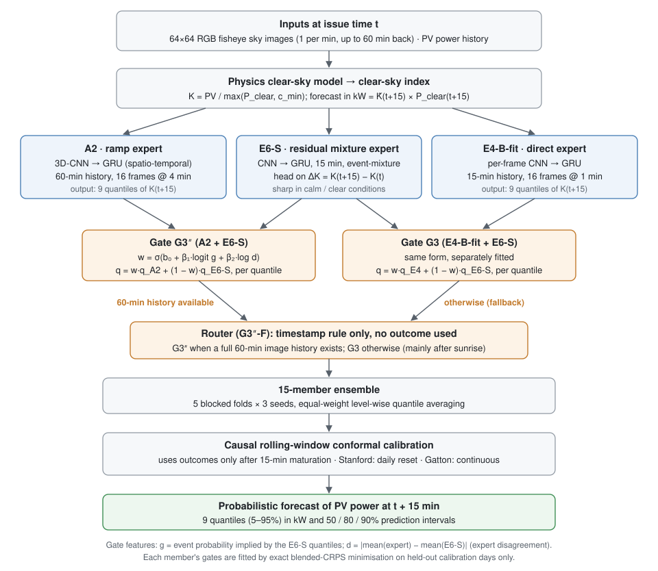

# SHADOW-MoE

**Probabilistic 15-minute-ahead solar power forecasting from ground-based sky images, using a disagreement-gated mixture of experts, evaluated on pre-registered, one-shot sealed tests at two sites.**

[](LICENSE)
[](pyproject.toml)
[](#research-status)

## Overview

**Research question.** Can a forecaster that routes between specialised sky-image experts produce better probabilistic 15-minute PV forecasts than its strongest single expert? Does that advantage hold at a second, very different site?

**What this repository contributes**
- **A gated forecaster, G3″-F.**
  - It combines a 3D-CNN ramp expert (60-minute image history) with a residual event-mixture expert that is sharp in calm conditions.
  - A logistic gate blends the two. Its inputs include their *disagreement*.
  - A timestamp rule falls back to a 15-minute direct expert when 60 minutes of history are not yet available.
  - The output is 9 predictive quantiles, made from a 15-member ensemble and calibrated by causal rolling conformal prediction.
- **Two one-shot sealed evaluations**, each with a frozen protocol, hash-verified model inventories and raw outputs committed before interpretation:
  - Stanford **SKIPP'D**, a 30 kW rooftop array in California;
  - **Gatton**, a 3.275 MW plant in Queensland, Australia.
- **Complete reporting of what did not work:** hypotheses that were not confirmed, missed calibration targets, failed zero-shot transfer and a null result for physics-informed losses.

## Results at a glance

### Primary hypothesis (confirmatory, pre-registered at both sites)

The final gated model G3″-F against its direct expert E4-B-fit.
- **Metric:** overall CRPS in kW (lower is better).
- **Interval:** 95% CI of the paired difference from a day-block bootstrap (10,000 resamples, stratified sunny/cloudy).

| Site (sealed test) | Forecasts | G3″-F | E4-B-fit | Difference [95% CI] | Verdict |
|---|---|---|---|---|---|
| Stanford SKIPP'D (20 days) | 13,266 | 1.006 | 1.117 | −0.111 [−0.149, −0.075] (−9.9%) | **Confirmed** |
| Gatton (21 days) | 13,311 | 116.9 | 163.8 | −46.9 [−57.4, −37.8] (−28.6%) | **Confirmed** |

CRPS is in kW and scales with plant size, so values are not comparable across sites.

### Secondary, descriptive and exploratory results

| Question | Type | Stanford SKIPP'D | Gatton |
|---|---|---|---|
| G3″-F beats smart persistence (CRPS) | pre-registered secondary | **Confirmed:** 1.006 vs 1.707; −0.701 [−0.823, −0.582] | **Not confirmed:** 116.9 vs 134.0; −17.0 [−39.2, +2.5] |
| Ramp CRPS vs E4-B-fit | Stanford: pre-registered non-inferiority · Gatton: descriptive | **Not established:** −0.117 [−0.244, +0.031] | **Worse:** +15.7 [+0.8, +30.7] |
| Calibrated 90% coverage (target 0.87–0.93) | pre-specified target | **Not met:** 0.935 (over-covers) | **Not met:** 0.864 (under-covers) |
| Standalone residual expert E6-S vs G3″-F | Stanford: descriptive · Gatton: exploratory | E6-S worse (1.090 vs 1.006) | **E6-S better** (96.5 vs 116.9) |
| Forecast anticipates PV changes (lag analysis) | Stanford: exploratory · Gatton: descriptive | No; best lag 15 min | No; best lag 15 min |

**Further Gatton results**
- **Zero-shot transfer fails.** The frozen Stanford model, applied without retraining, scores 597.3 kW CRPS, far worse than persistence. Flipping the image orientation does not help.
- **Pre-training gives no measurable benefit.** Fine-tuning from Stanford was not established to beat training from scratch: −1.5 [−6.6, +5.9] kW.
- **Clear days are a weakness.** The gated model loses to persistence on the four sunny test days, and that is the main reason it misses the persistence comparison (exploratory).

**Physics-informed losses (Phase F, development only).** Adding solar-physics terms to the ramp expert's training objective changed CRPS by ≤ 0.6%. No variant met the pre-registered selection rule, so this is a null result in practice.

**What these results do and do not show.**
- **They do show:** the gain over the direct expert replicated at a second site.
- **They do not show** universal superiority:
  - at Gatton a simpler component (E6-S) scored better overall, and persistence was not beaten;
  - ramps remain the main weakness;
  - neither site met the calibration target.

Full reports:
- [Stanford test report](reports/gate5_test_report.md)
- [Gatton test report](reports/phaseE_gatton_test_report.md)

## Method



1. **Clear-sky normalisation.**
   - A physical clear-sky model gives the power the array would produce under a clear sky, P_clear(t).
   - Every model forecasts the clear-sky index K = PV / max(P_clear, c_min), which separates clouds from the daily and seasonal cycle.
   - The kW forecast is K̂(t+15) × P_clear(t+15).
   - At Stanford, this normalisation reduced development CRPS by 22%.
2. **Experts.** All are image encoders followed by a GRU, with a quantile or mixture head:
   - **A2:** 3D-CNN over 60 minutes of images (16 frames at 4-minute stride); the ramp expert.
   - **E6-S:** an event-mixture head on the 15-minute change ΔK; sharp in calm conditions.
   - **E4-B-fit:** per-frame CNN over 15 minutes; the direct expert.
3. **Disagreement-guided gate.**
   - w = σ(b₀ + β₁·logit g + β₂·log d), where g is the event probability implied by E6-S's quantiles and d is the gap between the two experts' mean forecasts.
   - The two quantile functions are blended level by level.
   - Gates are fitted by exact blended-CRPS minimisation on held-out calibration days only ([`src/gate7b.py`](src/gate7b.py)).
4. **Routing and fallback.**
   - G3″ (A2 + E6-S) is used whenever a full 60-minute image history exists (93% of Stanford test forecasts).
   - Otherwise, mainly just after sunrise, G3 (E4-B-fit + E6-S) is used.
   - The rule uses timestamps only ([`src/final_eval.py`](src/final_eval.py)).
5. **Ensemble and calibration.**
   - 15 members (5 blocked folds × 3 seeds) are averaged quantile by quantile.
   - Intervals are corrected by causal rolling-window conformal prediction, which uses only outcomes observed 15 minutes later.
   - Stanford used a daily reset. Gatton used the continuous variant selected in the [Phase C calibration study](reports/phaseC_report.md).
   - No finite-sample coverage guarantee is claimed under temporal dependence.

Training recipe, expert details, development history and equations: [docs/development_history.md](docs/development_history.md).

## Datasets and preprocessing

| | Stanford SKIPP'D | Gatton |
|---|---|---|
| Source | Nie et al., Stanford Digital Repository, [DOI 10.25740/dj417rh1007](https://doi.org/10.25740/dj417rh1007) | Xu and Ma, University of Queensland, [DOI 10.48610/bd7e108](https://doi.org/10.48610/bd7e108) |
| Licence | CC BY 4.0 | Permitted Re-Use with Commercial Use Restriction |
| PV system | ≈ 30 kW rooftop array | 3.275 MW plant (mixed fixed/tracking, AC-capped) |
| Images used | 64×64 RGB fisheye, 1 per minute (as distributed) | 2048×1536 every 10 s → nearest frame per minute, circle-masked, 64×64 |
| Development | 497 days (2017–2019) | 83 days (2020-01-23 to 2020-04-15) |
| Sealed test | 20 official test days (10 sunny, 10 cloudy) | last 21 days (2020-04-16 to 2020-05-06) |

**Preprocessing**
- **Common construction:** each sample uses 16 frames over [t − 15, t] (or 60 min for A2) and the PV target at t + 15 min. Image and PV records are matched within ±30 s.
- **Stanford:** this matching recovers the official sample counts and is a documented deviation from the benchmark's exact-timing construction ([`reports/protocol_notes.md`](reports/protocol_notes.md), [`reports/dataset_preprocessing_audit.md`](reports/dataset_preprocessing_audit.md)).
- **Gatton:** every preprocessing rule and parameter was fixed on development data before any test row was read, including four documented amendments:
  - missing PV values;
  - the export sign convention;
  - clear-sky geometry;
  - the mixed fixed/tracker plant model.

  See [`reports/phaseE_gatton_prereg.md`](reports/phaseE_gatton_prereg.md).

## Installation and quick start

These steps need Python 3.11. Training needs a CUDA GPU; the work used one NVIDIA RTX 5000 Ada (32 GB).

```bash
git clone https://github.com/abdulsamad2/solar-architecher.git
cd solar-architecher
python -m venv .venv
source .venv/bin/activate          # Windows: .venv\Scripts\activate
pip install torch torchvision --index-url https://download.pytorch.org/whl/cu128
pip install -r requirements.txt
pytest                             # unit tests; no data required
```

Then download SKIPP'D (`2017_2019_images_pv_processed.hdf5`, `times_trainval.npy`, `times_test.npy`) into `data/raw/` and build the development manifests:

```bash
python -m src.skippd               # forecast manifest (±30 s matching)
python -m src.folds                # blocked 5-fold development folds
pytest -m realdata                 # opt-in real-data integrity audits
```

**Notes**
- **Weights:** trained model weights are **not distributed**. The full training, gating and rehearsal sequence for both sites is in [docs/reproducibility.md](docs/reproducibility.md).
- **Gatton paths:** the Gatton modules read a data path set as a constant at the top of each file; edit it to point at your copy.
- **Test status:** the Gatton guard tests are skipped unless Gatton data are present. When the data are present, one of them (`test_official_run_refuses_without_recorded_token`) fails. That test was written before the official run, and the approval-token file it checks for is now committed by design.

> **Sealed tests.** `src.final_execute` / `src.final_eval.run_test` (Stanford) and `src.gatton_execute official` / `src.gatton_eval.run_test` (Gatton) are one-shot evaluation commands. Both have already been executed and must not be rerun. Their guards refuse to run while results exist.

## Reports and figures

**Final test reports**
- [Stanford Gate 5 report](reports/gate5_test_report.md)
- [Gatton Phase E report](reports/phaseE_gatton_test_report.md)

**Pre-registrations**
- [Stanford test](reports/test_eval_prereg.md)
- [Gatton](reports/phaseE_gatton_prereg.md)
- [Calibration study](reports/phaseC_calibration_prereg.md)
- [Physics losses](reports/phaseF_physics_prereg.md)
- [Published-method comparison](reports/phaseA_comparability_prereg.md)

**Studies**
- Phase A, comparison with published methods: [report](reports/phaseA_report.md)
- Phase C, calibration under temporal shift: [report](reports/phaseC_report.md)
- Phase F, physics-informed losses: [report](reports/phaseF_report.md)
- Dataset preprocessing: [audit](reports/dataset_preprocessing_audit.md)
- Related work: [review](reports/related_work.md)

**Raw results**
- [Stanford results](reports/test_results.json)
- [Gatton results](reports/phaseE_gatton_test_results.json)
- [Stanford lag analysis](reports/lag_analysis.json)
- [Gatton lag analysis](reports/phaseE_gatton_test_lag.json)

**Figures and drafts**
- **Figures:** [`reports/figures/`](reports/figures/) contains a test-day forecast, per-day CRPS, interval coverage, the camera change, the PV/clear-sky decline and the Phase F figures. Generate them with `python -m src.figures`.
- **Working manuscript:** [`reports/paper_draft.md`](reports/paper_draft.md).

**Comparison with published methods.** Phase A compared G3″-F with published SUNSET, SkyGPT and PV-MM-Diffusion numbers on the SKIPP'D test and on SkyGPT's public external test set.
- **Unpaired:** these are comparisons against published point estimates. The protocols differ in sample matching and CRPS estimation. We therefore do not claim superiority over these methods.
- **Interval scores are comparable, not better.** Our 90% interval score is comparable to PV-MM-Diffusion's.
- **Coverage on SkyGPT's set:** our intervals under-cover there (0.77 at 90%).

Details: [docs/development_history.md §4](docs/development_history.md#4-context-published-results-phase-a).

## Reproducibility and scientific integrity

- **Pre-registration:** hypotheses, metrics and decision rules were committed before the corresponding results existed. Amendments are dated and justified in the same files.
- **Leakage control:** blocked folds with purge days. Gates, thresholds and calibration windows are fitted on development data only.
- **One-shot sealed tests:**
  - each test ran once, from a clean committed tree, after an explicit recorded approval token;
  - all model files were SHA-256 verified before unsealing;
  - raw predictions and metrics were committed unchanged before any interpretation.
- **Provenance:**

  | | Stanford | Gatton |
  |---|---|---|
  | Execution | `e4b1048` | `9f5164e` (scientific freeze `dd39740`) |
  | Raw outputs | `cd7c30a` | `59ccbcd` |
  | Deviations | two aborted pre-read attempts, documented | none |

  Full table and logs: [docs/reproducibility.md](docs/reproducibility.md#5-sealed-test-execution-provenance-only-do-not-run).
- **Result labels:** results are labelled confirmatory, descriptive or exploratory, and post-hoc analyses are never presented as confirmatory.

## Limitations and negative results

- **Only two sites:** 64×64 images, a single season at Gatton (summer to autumn) and an estimated PV-array geometry there.
- **Not better than persistence at Gatton:** on clear days the gated model was clearly worse.
- **Not always better than its own components:** the standalone E6-S expert scored better overall at Gatton.
- **Ramps remain unsolved:**
  - ramp CRPS was not better than the direct expert's, and was worse at Gatton;
  - at nominal 90%, ramp interval coverage was only 0.65–0.75;
  - misses are directional: outcomes fall above the interval on up-ramps and below it on down-ramps.
- **No anticipation:** at both sites the forecast changes follow the observed changes about 15 minutes later. The gains come from a better forecast level and spread, not from predicting cloud arrivals.
- **Calibration:** the 90% target was missed at both sites, in opposite directions.
- **Transfer:** models do not transfer without site-specific training, and Stanford pre-training gave no measurable benefit.
- **Physics-informed losses:** no practically meaningful improvement.
- **Data caveats at Stanford:**
  - the ±30 s sample matching differs from the benchmark's original construction;
  - the camera was replaced in May 2019;
  - the PV/clear-sky ratio declines by an apparent 2.2%/yr.

  These are documented in the [preprocessing audit](reports/dataset_preprocessing_audit.md).

## Citation

Please cite this repository (metadata in [`CITATION.cff`](CITATION.cff)) together with the datasets you use:

```bibtex
@software{laghari_shadow_moe_2026,
  author = {Laghari, Abdul Samad},
  title  = {{SHADOW-MoE}: probabilistic 15-minute solar power forecasting from sky images},
  year   = {2026},
  url    = {https://github.com/abdulsamad2/solar-architecher}
}
```

- **Stanford data:** Y. Nie, X. Li, A. Scott, Y. Sun, V. Venugopal, A. Brandt. *SKIPP'D: a SKy Images and Photovoltaic Power Generation Dataset for short-term solar forecasting.* Solar Energy, 2023. Dataset DOI [10.25740/dj417rh1007](https://doi.org/10.25740/dj417rh1007).
- **Gatton data:** S. Xu, H. Ma. *Gatton Sky Image and PV Generation 2020.* The University of Queensland, 2023. DOI [10.48610/bd7e108](https://doi.org/10.48610/bd7e108).

## Acknowledgments and licences

- **This repository's code** is released under the [MIT licence](LICENSE).
- **Vendored helper:** [`src/official/relative_op_func.py`](src/official/relative_op_func.py) is © the SKIPP'D authors, MIT licence ([`src/official/LICENSE_SKIPPD`](src/official/LICENSE_SKIPPD)).
- **Data licences:**
  - SKIPP'D is distributed under CC BY 4.0.
  - The Gatton dataset is distributed under "Permitted Re-Use with Commercial Use Restriction". Check the dataset's own terms before any commercial use.
- **Acknowledgments:** we thank the SKIPP'D authors at Stanford University and the authors of the Gatton dataset at the University of Queensland for making their data public.

## Research status

- **Done:** both sealed evaluations, the published-method comparison, the calibration study and the physics-loss study.
- **In progress:** a single manuscript covering both sites. It has not yet been peer-reviewed.
- **Nature of the code:** this is research code for reproducing the reported experiments, not a production forecasting system.

Author: Abdul Samad Laghari.
