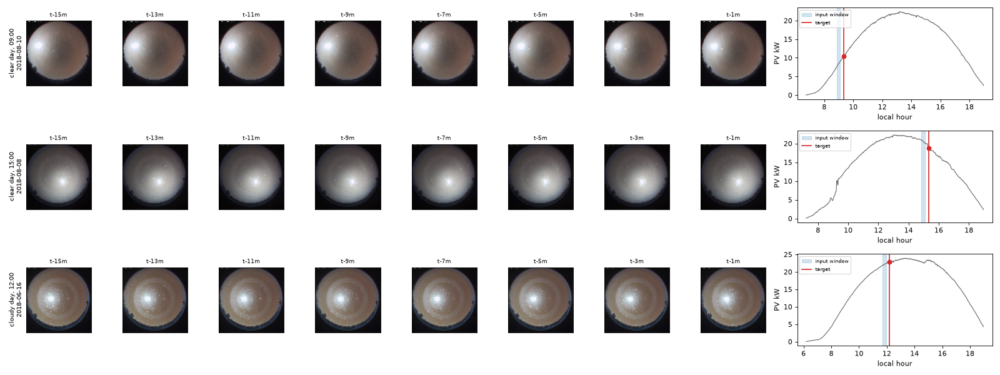
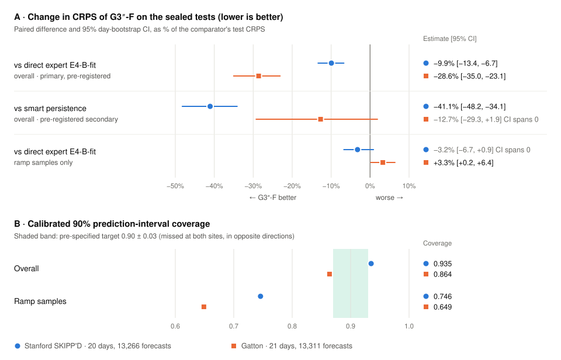
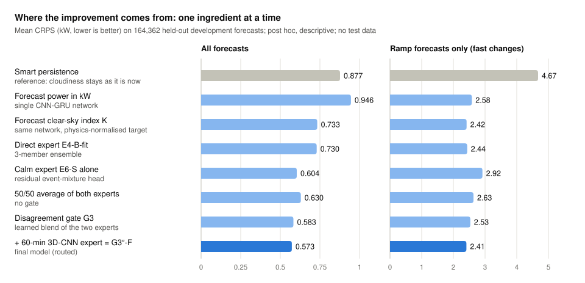
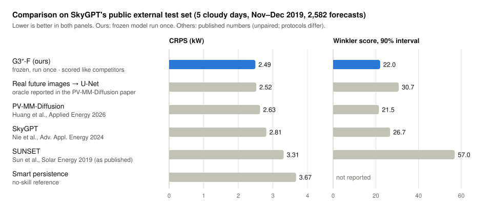
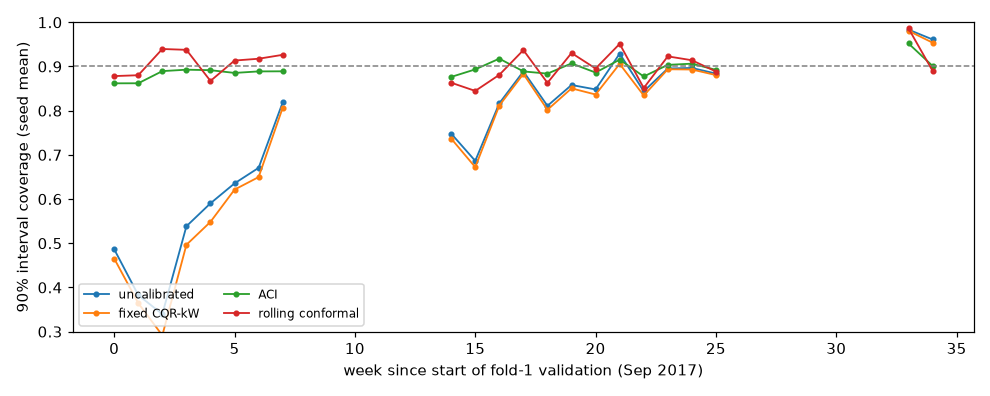
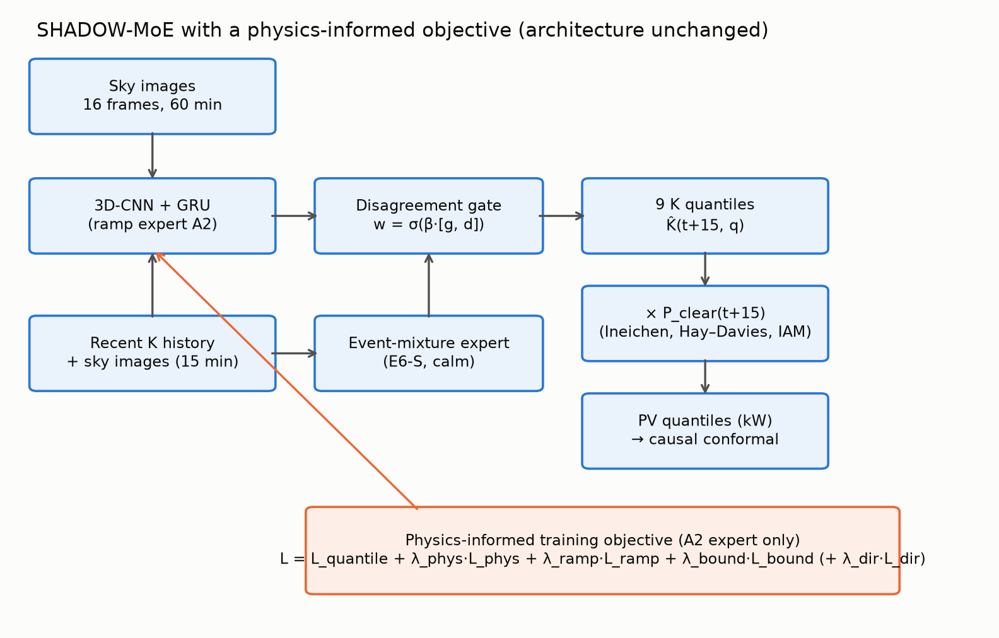
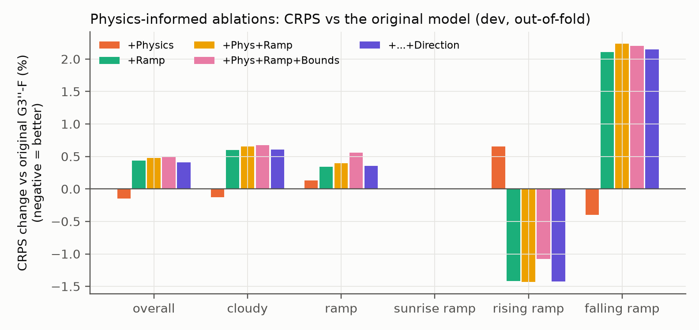
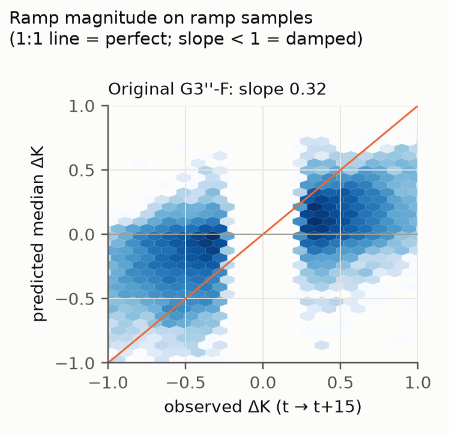
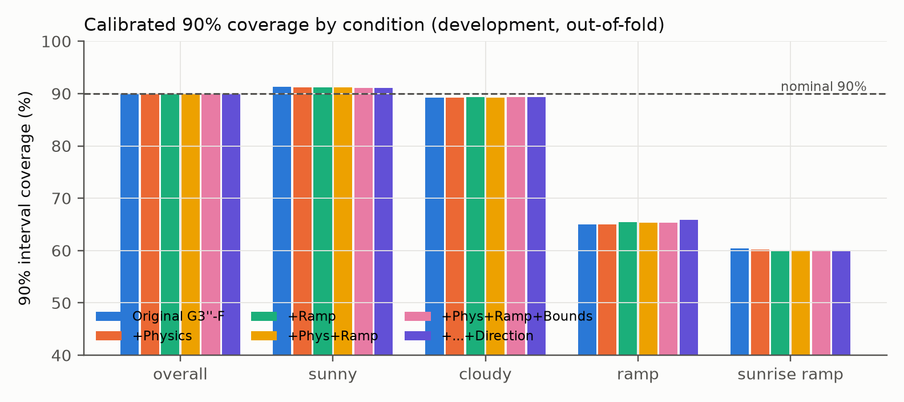
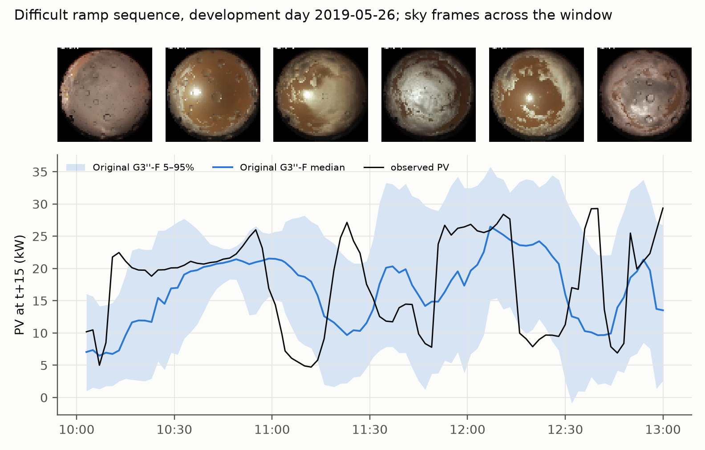

<div align="center">

# SHADOW-MoE

**Probabilistic 15-minute solar power forecasting from ground-based sky images**

A disagreement-gated mixture of sky-image experts, evaluated in a pre-registered, one-shot sealed test on the Stanford SKIPP'D benchmark

[](LICENSE)
[](pyproject.toml)
[](#13-research-status)

[Summary](#shadow-moe) · [Abstract](#abstract) · [Data](#2-data) · [Method](#3-method) · [Results](#4-results) · [Published models](#5-comparison-with-published-models) · [Follow-up studies](#6-follow-up-studies) · [Limitations](#8-limitations-and-negative-results) · [Reproduce](#10-installation-and-quick-start) · [Cite](#11-citation)

</div>

> [!TIP]
> **Plain-language summary**
>
> **The problem.** Solar panels make less power when a cloud passes in front of the sun. Grid operators and battery controllers want to know, a few minutes ahead, how much power is coming. A camera pointed at the sky can see clouds before they reach the sun.
>
> **What we built.** A forecasting system that looks at the last hour of sky photos and predicts the solar power 15 minutes later. It gives a *range with probabilities*, for example "most likely 18 kW, and 90% sure it will be between 9 and 24 kW", not a single number.
> - It uses several specialist neural networks (*experts*). One is good at calm, clear skies; another watches cloud motion over a longer period.
> - A small *gate* decides how much to trust each one. It trusts the cloud-motion expert more when the two experts disagree.
>
> **What we found.**
> - On 20 test days that were locked away until the very end, the system's forecast error was **9.9% lower** than that of the best single network.
> - It was about **40% lower** than the standard "the sky will stay as it is" forecast.
> - Its scores are in the range of published methods such as SkyGPT, though those comparisons use published numbers and slightly different protocols, so we do not claim it is better.
>
> **What it cannot do yet.**
> - It does not foresee *sudden* changes, such as a cloud covering the sun. It reacts to them about 15 minutes late, like the simple forecast does.
> - Its uncertainty ranges were a little too wide on the test days.
> - Adding physics rules to its training did not help.

## Abstract

**Background.** Short-term forecasts of photovoltaic (PV) power from ground-based sky images can support grid balancing and storage control. However, deep-learning forecasters tend to lag sudden cloud-induced *ramps*.

**Methods.**
- **G3″-F**, a probabilistic 15-minute-ahead forecaster, blends two experts that work in clear-sky-index space:
  - a 3D-CNN ramp expert with a 60-minute image history;
  - a residual event-mixture expert that is sharp in calm conditions.
- **Gate:** a logistic gate whose inputs include the experts' disagreement. It is fitted by exact CRPS minimisation on held-out calibration days.
- **Fallback:** a direct 15-minute expert is used when a 60-minute history is unavailable.
- **Ensemble and calibration:** 15 members, calibrated by causal rolling-window conformal prediction.
- **Protocol:** all design decisions were pre-registered on 497 development days. The official 20-day SKIPP'D test set was evaluated exactly once.

**Results.**
- **Primary hypothesis confirmed:** G3″-F reduced overall CRPS from 1.117 to 1.006 kW against the strongest single expert (−9.9%; paired day-bootstrap 95% CI of the difference [−0.149, −0.075] kW).
- **Against smart persistence:** −41% (CI [−0.823, −0.582] kW).
- **Not met:**
  - ramp non-inferiority (CI upper bound +0.031 kW above the 0.02 kW margin);
  - 90% interval coverage within ±0.03 of nominal (observed 0.935).
- **No anticipation:** a lag analysis shows that forecast changes follow observed changes by about 15 minutes.
- **Follow-up studies** (pre-registered; the sealed test was not reused):
  - on SkyGPT's public external test set, CRPS is in the range of published methods;
  - continuous conformal schemes are more robust than the daily reset;
  - physics-informed training losses give no practically meaningful gain.

**Conclusion.** Gating between experts improves probabilistic accuracy and sharpness. Anticipating ramps remains limited by what the images reveal, not by the training objective.

---

## 1. Introduction

**Why it matters.** Solar output can fall by more than half within a minute when a cloud covers the sun. Forecasts for the next 5–30 minutes help grid operators, battery systems and plant controllers prepare for such *ramps*.

**Why sky cameras.** Satellites are too coarse and too slow for this horizon. A fisheye camera on the ground sees the whole sky, and the clouds that are about to shade the panels.

**Why a probability forecast.** A single predicted number hides how uncertain the future is. A *probabilistic* forecast gives a full distribution (here 9 quantiles) from which a user can read a best guess and ranges of any confidence level.

**Research question.** Can a forecaster that routes between specialised sky-image experts beat its strongest single expert in probabilistic accuracy, under a strict one-shot test?

**Contributions**
1. **G3″-F**, a disagreement-gated mixture of a 60-minute 3D-CNN ramp expert and a calm-condition event-mixture expert, with a timestamp-based fallback and causal conformal calibration.
2. **A pre-registered, one-shot evaluation** on the official SKIPP'D test set, with hash-verified models and raw outputs committed before interpretation.
3. **Three pre-registered follow-up studies:**
   - a comparison with published methods;
   - calibration under temporal shift;
   - a physics-informed training objective.
4. **Full reporting of negative results:** ramp lag, missed coverage target and a null result for physics losses.

## 2. Data

### 2.1 The SKIPP'D benchmark

**SKIPP'D** (SKy Images and Photovoltaic Power generation Dataset) comes from Stanford University and covers 2017–2019 ([DOI 10.25740/dj417rh1007](https://doi.org/10.25740/dj417rh1007), CC BY 4.0).
- **Sky images:** 64×64-pixel colour fisheye images of the whole sky, one per minute.
- **PV output:** the 1-minute output of a ≈ 30 kW rooftop array about 125 m from the camera.
- **What is missing:** there are no cloud labels, irradiance sensors or weather data. The model must learn the link between clouds and power from the images alone.

<p align="center">
  
</p>

*Figure 1. What the model sees.*
- **Each row:** one forecast example, with eight of the 16 input frames (t − 15 … t − 1 min).
- **Right-hand panels:** the day's PV curve. The blue band is the input window, and the red dot is the value to be predicted 15 minutes later.
- **The sun:** it is the bright spot.

| Split | Records | Days | Forecast samples |
|---|---|---|---|
| Development (training, tuning, calibration) | 349,372 | 497 | 164,362 |
| Official test (sealed until the final run) | 14,003 | 20 (10 sunny, 10 cloudy) | 13,266 |

### 2.2 Preprocessing

**Samples.** Each sample uses 16 frames over the last 15 minutes (or 60 minutes at a 4-minute stride for the ramp expert), the recent PV history, and the PV value 15 minutes ahead as the target.

**Timestamp matching.**
- **The problem:** the public files are thinned to about one record per minute, and their timestamps drift by up to ±30 s. Exact matching would lose 19% of samples.
- **Our fix:** we match each frame to the nearest record within ±30 s. This recovers the official sample counts.
- **Status:** it is a documented deviation from the benchmark's construction ([`reports/protocol_notes.md`](reports/protocol_notes.md)).

**Development folds.** The development days are cut into 5 contiguous blocks with 1-day gaps (*blocked folds*), so that training and validation never share a weather period. A calibration hold-out (every 5th block of 10 training days) is never used for training. It is used only to fit the gates.

**Data quality findings** ([`reports/dataset_preprocessing_audit.md`](reports/dataset_preprocessing_audit.md))
- **Camera replaced:** the camera was changed on 2019-05-22, and the sky's colour balance shifted.
- **Apparent decline:** clear-day output declines by about 2.2% per year relative to a fixed physical model. That is more than typical panel ageing.

<details>
<summary><b>Show the two data-quality figures</b></summary>
<br>
<p align="center"></p>

*Figure A1. Camera change.* The midday red/blue colour ratio of the sky jumps from about 1.1–1.3 to about 2.0 when the camera was replaced on 2019-05-22. A model trained on the old camera sees "different-looking" skies afterwards.

<p align="center"></p>

*Figure A2. Apparent output decline.*
- **What is plotted:** on clear days, measured PV divided by the theoretical clear-sky PV.
- **What it shows:** a seasonal cycle (grey) and a season-adjusted decline of 2.2% per year (orange).
- **Interpretation:** soiling, aerosol-model error or data artefacts likely contribute. The model absorbs this through a scale factor fitted on training days only.
</details>

## 3. Method

### 3.1 Separating clouds from the sun's daily cycle

PV output rises and falls every day simply because the sun moves. To let the networks focus on clouds, every model forecasts the **clear-sky index**:

> **K = measured power / clear-sky power**

- **Clear-sky power** P_clear(t) is what the array *would* produce under a perfectly clear sky. It is computed from the sun's position with standard physics models: Ineichen clear-sky irradiance, Hay–Davies transposition and an incidence-angle loss.
- **What K values mean:**
  - K ≈ 1: clear sky;
  - K ≈ 0.3: a thick cloud blocks the sun;
  - K > 1: briefly possible when cloud edges reflect extra light.
- **From K back to kW:** the forecast is K̂(t + 15 min) × P_clear(t + 15 min).
- **Effect:** this alone reduced development CRPS by 22% (Figure 6).

### 3.2 Architecture

<p align="center">
  
</p>

*Figure 2. The G3″-F forecaster.*
- **Experts:** three neural-network experts forecast the future clear-sky index.
- **Gates:** a gate blends a cloud-motion expert with a calm-sky expert.
- **Routing:** a timestamp rule chooses the 60-minute or 15-minute branch.
- **Ensemble and calibration:** 15 independently trained copies are averaged, and the ranges are calibrated on outcomes that have already been observed.

| Component | What it is | In plain words |
|---|---|---|
| **A2**, ramp expert | 3D-CNN → GRU over 60 min of images (16 frames, 4-min stride); 9 quantiles of K | Watches how clouds move over the last hour |
| **E6-S**, residual mixture expert | CNN → GRU over 15 min; event-mixture head on the change ΔK = K(t+15) − K(t) | Very precise when the sky is calm; predicts *changes* from now |
| **E4-B-fit**, direct expert | Per-frame CNN → GRU over 15 min; 9 quantiles of K | The strongest single network; used as the comparison and as the fallback |
| **Gate** | w = σ(b₀ + β₁·logit g + β₂·log d), where g is the event probability implied by E6-S and d is the gap between the two experts' mean forecasts | Leans on the cloud-motion expert when the experts disagree or a change looks likely |
| **Router** | G3″ (A2 + E6-S) when a full 60-min history exists (93% of test forecasts); otherwise G3 (E4-B-fit + E6-S) | After sunrise there is not yet an hour of images, so a shorter-memory pair is used |
| **Ensemble** | 5 blocked folds × 3 seeds = 15 members, averaged quantile by quantile | Averaging many independently trained copies reduces luck |
| **Calibration** | Causal rolling-window conformal correction, using outcomes only after they are observed (15-min delay); daily reset | Widens or narrows the ranges based on how well recent ranges worked |

**Training (all experts)**
- **Optimiser:** AdamW, learning rate 1e−4 with cosine decay, weight EMA.
- **Schedule:** at most 15 epochs, with early stopping on the pinball (quantile) loss.
- **Gates:** fitted by exact blended-CRPS minimisation on the calibration hold-out days only ([`src/gate7b.py`](src/gate7b.py)).
- **Details:** [docs/development_history.md](docs/development_history.md).

### 3.3 How forecasts are scored

| Measure | Definition | In plain words |
|---|---|---|
| **CRPS** (kW) | Continuous ranked probability score of the predictive distribution; equals the mean absolute error for a single-number forecast | The average error of the *whole* forecast range. Lower is better |
| **Coverage** | Share of outcomes inside the stated 50 / 80 / 90% interval | A 90% range should contain the real value 90% of the time |
| **Interval (Winkler) score** | Interval width plus a penalty for each miss | Rewards ranges that are narrow *and* correct |
| **Smart persistence** | K(t + 15) = K(t) | "The sky stays as cloudy as it is now." A standard baseline that is hard to beat at short horizons |
| **Ramp** | \|ΔK over 15 min\| ≥ 0.279 (threshold frozen before testing) | A sudden large change, such as a cloud covering the sun |
| **95% CI** | Paired day-block bootstrap, 10,000 resamples, stratified sunny/cloudy | The plausible range of the true difference. If it excludes 0, the difference is unlikely to be chance |

### 3.4 Protocol

**Pre-registration.** Every development stage has a pre-registration and a report in [`reports/`](reports/). The final protocol ([`reports/test_eval_prereg.md`](reports/test_eval_prereg.md)) fixed the following before the test set was opened:
- the model;
- five hypotheses (H1 primary, H2–H5 secondary);
- the metrics and decision rules.

**Checks before unsealing**
- a development-only dry run;
- a leakage audit;
- SHA-256 hashes of all 140 model files.

**The test run.** The test was then executed **once**, and its raw outputs were committed before any analysis.

## 4. Results

All numbers in this section come from the single official test run ([`reports/test_results.json`](reports/test_results.json), [`reports/gate5_test_report.md`](reports/gate5_test_report.md)) unless marked *development*.

### 4.1 Pre-registered hypotheses

| Hypothesis | Estimate [95% CI] | Verdict |
|---|---|---|
| **H1 (primary):** overall CRPS, G3″-F − E4-B-fit | **−0.111 [−0.149, −0.075] kW** | **Confirmed** |
| H2: overall CRPS, G3″-F − smart persistence | −0.701 [−0.823, −0.582] kW | Confirmed |
| H2: cloudy-day CRPS, G3″-F − smart persistence | −1.208 [−1.454, −0.971] kW | Confirmed |
| H3: ramp CRPS non-inferior to E4-B-fit (margin 0.02 kW) | −0.117 [−0.244, +0.031] kW | **Not established** |
| H4: RMSE skill vs persistence (descriptive) | G3″-F 18.6%; our SUNSET port 16.2% | – |
| H5: calibrated 90% coverage within 0.90 ± 0.03 | 0.935 | **Not met** (too wide) |

<p align="center">
  
</p>

*Figure 3. The official test in one picture.*
- **Panel A, CRPS:**
  - each dot is how much lower (left) or higher (right) the error of G3″-F is than a comparison model, in percent;
  - the line is the 95% confidence interval;
  - the improvement over the best single network (top row) and over persistence is clear;
  - on ramps the interval crosses zero, so no gain is established there.
- **Panel B, coverage:**
  - the shaded band is the target for the 90% ranges;
  - overall and on sunny days the ranges are a little too wide, while on ramps they are too narrow.

> **In plain words.** The final system is clearly more accurate than any single network and far more accurate than the simple forecast. It does not yet handle sudden changes better than the best single network, and its uncertainty ranges are not yet perfectly sized.

### 4.2 Accuracy by weather condition

| Model | Overall | Sunny | Cloudy | Ramp | Non-ramp | Sunrise ramp | RMSE | MAE |
|---|---|---|---|---|---|---|---|---|
| **G3″-F (final)** | **1.006** | 0.074 | **1.939** | **3.510** | 0.583 | 0.808 | **2.959** | **1.411** |
| E4-B-fit (best single network) | 1.117 | 0.218 | 2.017 | 3.627 | 0.693 | 0.778 | 3.037 | 1.534 |
| G4 (15-min gate only) | 1.024 | 0.073 | 1.976 | 3.782 | 0.558 | 0.802 | 3.033 | 1.429 |
| E6-S (calm expert alone) | 1.090 | 0.073 | 2.108 | 4.281 | 0.551 | 0.900 | 3.274 | 1.499 |
| SUNSET (our re-implementation) | 1.719 | 0.475 | 2.965 | 4.815 | 1.197 | 1.070 | 3.046 | 1.719 |
| Smart persistence | 1.707 | 0.269 | 3.147 | 7.131 | 0.791 | 1.610 | 3.636 | 1.707 |

- **Units and samples:** CRPS is in kW. The strata contain 6,638 sunny, 6,628 cloudy, 1,916 ramp and 268 sunrise-ramp samples.
- **Sunny days:** the gated model is about **3× more accurate** than the best single network (0.074 vs 0.218 kW).
- **Cloudy days:** it is about **38% more accurate** than persistence.

### 4.3 What the forecasts look like

<p align="center">
  
</p>

*Figure 4. A cloudy official test day (2019-08-10).*
- **Black:** observed power.
- **Blue line:** the G3″-F median forecast.
- **Shaded:** its 20–80% and 5–95% ranges.
- **Dashed orange:** smart persistence, which copies every jump 15 minutes late.

The forecast range widens when the sky is broken and tightens in the clear afternoon. The median follows the level of the output but, like every model, cannot foresee the individual sharp drops.

<p align="center">
  
</p>

*Figure 5. Error on each of the 20 test days* (log scale; left is better).
- **Against the best single network:** G3″-F (blue dots) is better on 19 of 20 days.
- **Against SUNSET and persistence:** it is better on all 20 days.
- **Sunny days:** the gain is largest there (bottom half), because the calm-sky expert produces very tight, accurate ranges.

### 4.4 Where the improvement comes from

<p align="center">
  
</p>

*Figure 6. One ingredient at a time* (development data, held-out predictions; post hoc, descriptive). The four steps are:
- **Clear-sky index:** forecasting K instead of kW gives the largest single step (0.946 → 0.733).
- **Calm expert:** the calm-sky expert is very accurate overall (0.604) but poor on ramps (2.92).
- **Gate:** a learned gate beats a simple 50/50 average (0.583 vs 0.630).
- **Hour-long expert:** adding it brings ramp error back down (2.53 → 2.41), giving the final model (0.573).

### 4.5 Are the uncertainty ranges trustworthy?

| Nominal range | Coverage (overall) | Sunny | Cloudy | Ramp | Mean width (kW) | Interval score |
|---|---|---|---|---|---|---|
| 50% | 0.542 | 0.658 | 0.426 | 0.161 | 2.03 | 4.53 |
| 80% | 0.846 | 0.917 | 0.775 | 0.506 | 4.42 | 6.30 |
| 90% | 0.935 | 0.968 | 0.902 | 0.746 | 6.26 | 7.62 |

<p align="center">
  
</p>

*Figure 7. Stated vs actual coverage.*
- **How to read it:** points on the dotted diagonal would be perfect. Above the diagonal the ranges are too wide; below it, too narrow.
- **Left panel:** overall, development and SKIPP'D-test ranges are close to correct.
- **Right panel:** during ramps all ranges are much too narrow.
- **External test:** on SkyGPT's external days (orange) they are too narrow overall.

**Key observations**
- **Narrower and still well covered:** G3″-F's 90% ranges are 24% narrower than those of the best single network (6.26 vs 8.20 kW), at higher coverage.
- **Directional misses on ramps:**
  - on up-ramps, 30% of outcomes fall *above* the 90% range;
  - on down-ramps, 21% fall *below* it.

  The forecast arrives late.

### 4.6 Does the model anticipate changes? (exploratory)

A lag analysis ([`reports/lag_analysis.json`](reports/lag_analysis.json)) compares minute-to-minute changes in each model's median forecast with the observed changes in power.
- **Cloudy test days:** the forecast changes are **uncorrelated with the concurrent observed changes** (lag-0 correlation ≈ 0).
- **The 15-minute lag:** they are strongly correlated with the observed changes **15 minutes earlier**: G3″-F 0.87, smart persistence 0.98.

> **In plain words.** The system mostly reacts to what has already happened rather than predicting cloud arrivals, a behaviour known in the literature as "very smart persistence" (Paletta et al., 2021). Its gains come from a better *level* and better *ranges*, not from foresight.

### 4.7 Development vs test

| | Development (497 days) | Official test (20 days) |
|---|---|---|
| G3″-F overall CRPS | 0.573 | 1.006 |
| E4-B-fit overall CRPS | 0.730 | 1.117 |
| H1 difference [95% CI] | −0.157 [−0.170, −0.145] | −0.111 [−0.149, −0.075] |
| Ramp difference [95% CI] | −0.025 [−0.054, +0.005] | −0.117 [−0.244, +0.031] |
| 90% coverage, overall / ramp | 0.901 / 0.651 | 0.935 / 0.746 |

The test days are harder than development: 14.4% of test samples are ramps, against 10.0%. Both CRPS differences point in the same direction on both.

**Compute.** The complete one-shot run took 475 s on an NVIDIA RTX 5000 Ada, about **36 ms per forecast** amortised. That covers 15 members × 5 models, calibration and bootstraps.

## 5. Comparison with published models

The Phase A protocol was pre-registered ([`reports/phaseA_comparability_prereg.md`](reports/phaseA_comparability_prereg.md)); the full report is [`reports/phaseA_report.md`](reports/phaseA_report.md).

> [!NOTE]
> These comparisons use **published numbers**. They are not paired tests on identical predictions, and the protocols differ in sample matching and in how CRPS is estimated. They show that the results are *in the range* of published methods; they do **not** establish superiority.

**SUNSET on the SKIPP'D test.**
- Our re-implementation of SUNSET reproduces its published numbers to within 0.03 kW on the benchmark's exact-timing subset.
- On that subset, G3″-F reaches RMSE **2.949 kW** and forecast skill **18.1%**, against **3.03 kW** and **16.4%** published for SUNSET.

**SkyGPT's public external test set** (5 cloudy days, Nov–Dec 2019, 2,582 forecasts).
- These days were never seen during our development, and the frozen models were run once.
- The population was verified: our persistence scores 3.672 against the published 3.67.

<p align="center">
  
</p>

*Figure 8. Our model vs published models on SkyGPT's external test* (lower is better).
- **How ours was scored:** for a like-for-like CRPS, our 9 quantiles were turned into 30 samples and scored with the same estimator the competitors use ([`reports/estimator_check.json`](reports/estimator_check.json)).
- **Oracle:** the "real future images" row is a reference from the PV-MM-Diffusion paper that is given the *actual* future sky images.
- **Winkler score:** ours is comparable to PV-MM-Diffusion's (22.0 vs 21.5), **not better**.

| Model | CRPS (kW) | Winkler 90% | Source |
|---|---|---|---|
| **G3″-F (ours)**: own estimator / competitors' 30-sample estimator | **2.455 / 2.49** | 18.16 / **22.0** | one-shot run |
| Real future images → U-Net (oracle) | 2.52 | 30.72 | PV-MM-Diffusion paper |
| PV-MM-Diffusion (Huang et al., 2026) | 2.63 | 21.46 | published |
| SkyGPT (Nie et al., 2024) | 2.81 | 26.70 | published |
| SUNSET (Sun et al., 2019) | 3.31 | 56.95 | published |
| Smart persistence | 3.67 | – | published |

**Further checks**
- **Per day:** the CRPS gap to PV-MM-Diffusion also holds on each of the three days it reports individually: 0.95 vs 1.14, 2.44 vs 2.64 and 3.59 vs 3.83.
- **Coverage:** on these external days our 90% ranges under-cover (0.77).
- **Ramps:** ramp CRPS is not better than with the best single network.

## 6. Follow-up studies

These studies were pre-registered and run on **development data only**. The sealed test was not reused.

### 6.1 Calibration under temporal shift (Phase C)

**Question.** Does regime-aware calibration fix the under-coverage during ramps, and how robust is the frozen daily-reset method? Pre-registration: [`reports/phaseC_calibration_prereg.md`](reports/phaseC_calibration_prereg.md). Report: [`reports/phaseC_report.md`](reports/phaseC_report.md).

**Primary hypothesis: not confirmed.** Calibrating separately by regime did not raise ramp coverage for G3″-F: +0.001 [−0.013, +0.015]. It did help the single network E4-B-fit (+0.074), which suggests the gate already uses the same signals.

**The daily reset is fragile.** When its starting scores come from months earlier, it can fall to 0.61 coverage on a fold. For G3″-F, continuous rolling and adaptive conformal calibration (ACI) stay at **0.88–0.92 in every fold**.

<p align="center">
  
</p>

*Figure 9. Why adaptive calibration is needed* (earlier development study E4-CAL2, single network, fold 1).
- **Static methods** (uncalibrated, fixed CQR, in blue and orange) start far below the 90% target. The data drift over time.
- **Adaptive methods** (ACI, rolling conformal, in green and red) stay near the target from the first week.

### 6.2 Physics-informed training objective (Phase F)

**Question.** Does adding solar-physics terms to the ramp expert's training loss improve forecasts? The terms cover physical power consistency, ramp weighting, plausible K bounds and ramp direction. The architecture, gate, data and calibration are unchanged. Pre-registration: [`reports/phaseF_physics_prereg.md`](reports/phaseF_physics_prereg.md). Report: [`reports/phaseF_report.md`](reports/phaseF_report.md).

<p align="center">
  
</p>

*Figure 10. Where the physics terms act.* Only the training objective of the 3D-CNN ramp expert changes:

> L = L_quantile + λ_phys·L_phys + λ_ramp·L_ramp + λ_bound·L_bound (+ λ_dir·L_dir)

<p align="center">
  
</p>

*Figure 11. Effect of each physics variant on CRPS* (development, held-out; negative is better).
- **Overall:** every change is within about ±0.6%. The physics-consistency term alone improves CRPS by only 0.14%.
- **Ramp terms:** they help rising ramps (about −1.4%) but hurt falling ramps (about +2.1%).
- **Selection rule:** no variant met the pre-registered rule.

<p align="center">
  
</p>

*Figure 12. Predicted vs actual size of ramps.*
- **How to read it:** a perfect forecaster would lie on the orange 1:1 line.
- **What it shows:** the fitted slope is 0.32, so predicted ramps are about one-third of their real size.
- **Effect of the physics terms:** they did not change this.

<details>
<summary><b>Show the physics-variant coverage and a difficult ramp sequence</b></summary>
<br>
<p align="center"></p>

*Figure A3.* Calibrated 90% coverage is nearly identical for all variants: about 90% overall and about 65% on ramps. Ramp-direction terms add at most +0.8 percentage points.

<p align="center"></p>

*Figure A4.* A difficult broken-cloud morning (development day 2019-05-26). The sky frames above show clouds moving across the sun. The forecast range is wide and the median is smoothed and late, so it cannot follow swings that last only a few minutes.
</details>

> **In plain words.** Telling the network the rules of solar physics did not make it better at seeing clouds coming. The limit lies in what the 64×64 images reveal, not in how the network is trained.

## 7. Discussion

**What works.**
- **Gating:** routing between a calm-sky expert and a cloud-motion expert, based on their disagreement, gives a clear and robust gain. It holds on development data, on the sealed test (19 of 20 days) and on an external test set.
- **Sharper ranges:** the gated ranges are also much narrower.

**What does not work yet.**
- **Ramps:** like the published models we compare with, the system does not foresee ramps. It responds about 15 minutes late, and its predicted ramps are damped to about one-third of their size. Neither a better calibration method nor physics-based losses changed this.
- **Possible ways forward:** the evidence points to the *inputs*:
  - explicit cloud-motion estimates;
  - higher-resolution views around the sun;
  - a wider or upwind field of view.

**Calibration.** The daily-reset conformal method is accurate only when recent, similar data are available to start from. Continuous rolling calibration or ACI is the more robust choice for deployment.

## 8. Limitations and negative results

- **Data scope:** a single site, low-resolution (64×64) images and three years of data.
- **Ramps:**
  - ramp non-inferiority (H3) was not established;
  - at nominal 90%, ramp coverage was 0.746;
  - misses are directional.
- **No anticipation of changes:** forecast changes follow observed changes about 15 minutes later.
- **Calibration:**
  - the 90% target (H5) was missed on the test set (0.935, too wide);
  - the frozen daily-reset method is fragile under temporal shift.
- **Physics-informed losses:** no practically meaningful improvement.
- **Comparisons with published models** are unpaired and use differing protocols.
- **Data caveats:**
  - ±30 s sample matching;
  - a camera change in May 2019;
  - an apparent 2.2%/yr output decline.
- **Earlier variants that were not retained:**
  - explicit event supervision;
  - several alternative encoders (wide CNN, ConvGRU, transformer, frame difference);
  - hand-crafted sun-position and motion features.

  See [docs/development_history.md](docs/development_history.md).

## 9. Conclusion

**Main result.** A disagreement-gated mixture of sky-image experts, evaluated once on a sealed test under a pre-registered protocol, reduces probabilistic forecast error by 9.9% against its best single expert and by 41% against smart persistence. Its uncertainty ranges are 24% narrower.

**Main limitation.** Like other image-based forecasters, it does not anticipate sudden cloud-induced ramps. Changing the training objective does not help. Progress on ramps will most likely need richer inputs.

---

## 10. Installation and quick start

These steps need Python 3.11. Training needs a CUDA GPU; the work used one NVIDIA RTX 5000 Ada (32 GB).

```bash
git clone https://github.com/abdulsamad2/solar-architecher.git
cd solar-architecher
python -m venv .venv
source .venv/bin/activate          # Windows: .venv\Scripts\activate
pip install torch torchvision --index-url https://download.pytorch.org/whl/cu128
pip install -r requirements.txt
pytest                             # unit tests; no data required
```

Then download `2017_2019_images_pv_processed.hdf5`, `times_trainval.npy` and `times_test.npy` from the [Stanford Digital Repository](https://doi.org/10.25740/dj417rh1007) into `data/raw/`, and build the development manifests:

```bash
python -m src.skippd               # forecast manifest (±30 s matching)
python -m src.folds                # blocked 5-fold development folds
pytest -m realdata                 # opt-in real-data integrity audits
python scripts/make_readme_figures.py   # regenerate the README figures from the committed results
```

Trained model weights are **not distributed**. The full training, gating and rehearsal sequence is in [docs/reproducibility.md](docs/reproducibility.md).

> [!WARNING]
> **Sealed test: do not rerun.** `src.final_execute` / `src.final_eval.run_test` is a one-shot evaluation command. It has already been executed. Its guards refuse to run while results exist.

**Reproducibility and integrity**
- **Pre-registration:** every hypothesis was committed before its result existed.
- **Leakage control:** blocked folds, with gates and calibration fitted only on development data.
- **Before unsealing:** a [leakage audit](reports/leakage_audit_final.md) and SHA-256 verification of all 140 model files.
- **One-shot run:** the test ran once, and its raw outputs were committed unchanged (`cd7c30a`) before analysis.
- **Deviations:** two aborted attempts that never read test labels are documented in [`reports/test_execution_deviations.md`](reports/test_execution_deviations.md).
- **Full provenance:** [docs/reproducibility.md](docs/reproducibility.md#4-sealed-test-execution-provenance-only-do-not-run).

**Repository layout**

```
src/        data, models, training, gating, calibration, evaluation (final_eval.py = frozen test pipeline)
tests/      unit tests (pytest) and opt-in real-data audits (pytest -m realdata)
configs/    configurations, including the physics-loss ablations
scripts/    physics ablation runners and the README figure generator
experiments/ run records: config, metrics, histories, logs, raw test predictions (no weights)
reports/    pre-registrations, reports, audits, raw results and figures
docs/       development history, reproducibility guide, README figures
```

## 11. Citation

Please cite this repository (metadata in [`CITATION.cff`](CITATION.cff)) together with the dataset:

```bibtex
@software{laghari_shadow_moe_2026,
  author = {Laghari, Abdul Samad},
  title  = {{SHADOW-MoE}: probabilistic 15-minute solar power forecasting from sky images},
  year   = {2026},
  url    = {https://github.com/abdulsamad2/solar-architecher}
}
```

**References**
- Y. Nie, X. Li, A. Scott, Y. Sun, V. Venugopal, A. Brandt. SKIPP'D: a SKy Images and Photovoltaic Power Generation Dataset for short-term solar forecasting. *Solar Energy*, 2023. Dataset DOI [10.25740/dj417rh1007](https://doi.org/10.25740/dj417rh1007).
- Y. Sun, V. Venugopal, A. Brandt. Short-term solar power forecast with deep learning: exploring optimal input and output configuration (SUNSET). *Solar Energy* 188:730–741, 2019. [doi:10.1016/j.solener.2019.06.041](https://doi.org/10.1016/j.solener.2019.06.041).
- Y. Nie, E. Zelikman, A. Scott, Q. Paletta, A. Brandt. SkyGPT: probabilistic ultra-short-term solar forecasting using synthetic sky images from physics-constrained VideoGPT. *Advances in Applied Energy*, 2024. [doi:10.1016/j.adapen.2024.100172](https://doi.org/10.1016/j.adapen.2024.100172).
- Huang et al. PV-MM-Diffusion. *Applied Energy*, 2026.
- Q. Paletta, G. Arbod, J. Lasenby. Benchmarking of deep learning irradiance forecasting models from sky images: an in-depth analysis. *Solar Energy* 224:855–867, 2021. [doi:10.1016/j.solener.2021.05.056](https://doi.org/10.1016/j.solener.2021.05.056).

The full literature review is in [`reports/related_work.md`](reports/related_work.md).

## 12. Acknowledgments and licences

- **This repository's code** is released under the [MIT licence](LICENSE).
- **Vendored helper:** [`src/official/relative_op_func.py`](src/official/relative_op_func.py) is © the SKIPP'D authors, MIT licence ([`src/official/LICENSE_SKIPPD`](src/official/LICENSE_SKIPPD)).
- **Data licence:** SKIPP'D is distributed under CC BY 4.0.
- **Acknowledgments:** we thank the SKIPP'D authors at Stanford University for making their data public.

## 13. Research status

- **Done:** the development gates, the official SKIPP'D test (Gate 5), the published-model comparison (Phase A), the calibration study (Phase C) and the physics-loss study (Phase F).
- **In progress:** a manuscript. It has not yet been peer-reviewed.
- **Nature of the code:** this is research code for reproducing the reported experiments, not a production forecasting system.

Author: Abdul Samad Laghari.
